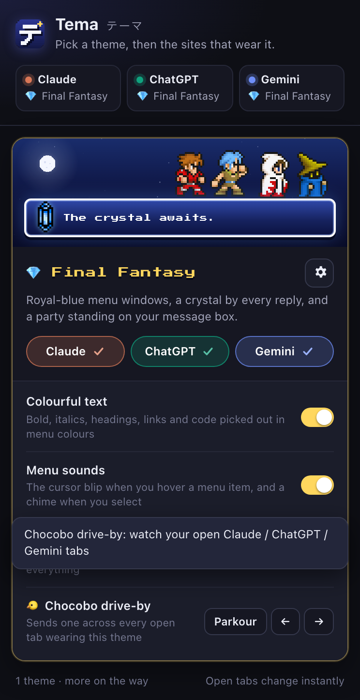
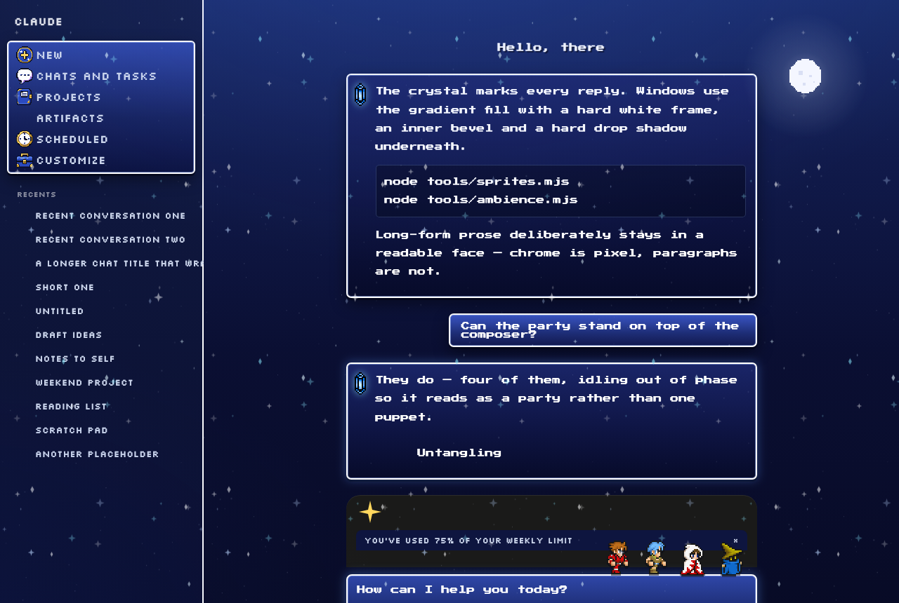
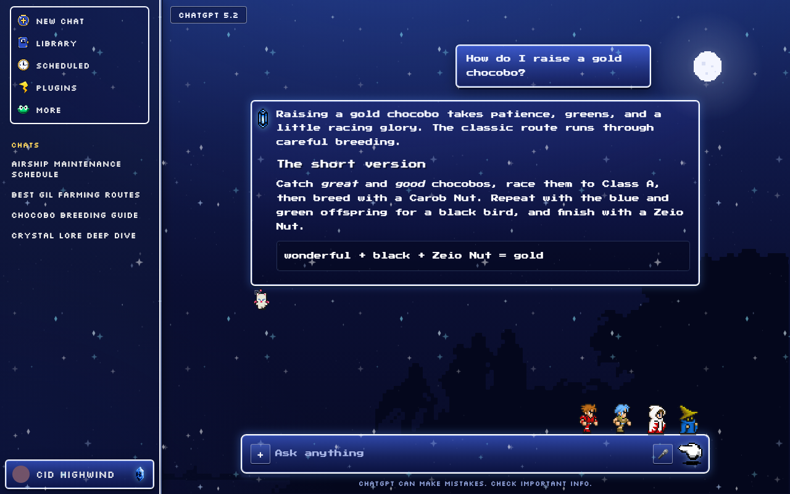
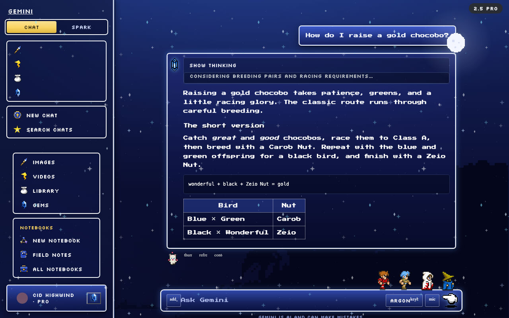

# Tema テーマ

Themes for **Claude**, **ChatGPT** and **Gemini**, in one browser extension.
Pick a theme, then tick the sites that wear it.

<p align="center"></p>

*Tema* is how Japanese says "theme" (テーマ, tēma).

## Themes

### 💎 Final Fantasy

Royal-blue menu windows with hard white frames, pixel fonts, a crystal beside
every reply, a four-person party standing on the message box, a moogle who
hops while the model works, menu sounds, a night sky with shooting stars, and
the occasional chocobo drive-by. Made separately for each site's own markup.

| claude.ai | chatgpt.com | gemini.google.com |
| :---: | :---: | :---: |
|  |  |  |

<sub>Rendered from the offline mocks in `tools/mocks/`, so the pictures carry
sample data, not anyone's chats.</sub>

Its settings (⚙ on the card): **Colourful text** (bold, italics, headings,
links and code in menu colours), **Menu sounds** (the cursor blip and the
select chime) and **Horizon scenery**. The **chocobo** buttons send one across
your open tabs right away; left alone, it visits on its own every few minutes.

More themes are on the way.

## Install (Chrome, Arc, Edge, Brave)

1. Download **`tema.zip`** from the
   [latest release](https://github.com/icpryde/tema/releases/latest) and unzip it.
2. Open `chrome://extensions` (`arc://extensions` in Arc).
3. Turn on **Developer mode** (top right).
4. Click **Load unpacked** and pick the unzipped `tema` folder.
5. Reload any open Claude, ChatGPT or Gemini tabs.
6. Click Tema's icon, and on a theme's card tick the sites it should be on.

Nothing is themed until you tick a site. Changes reach open tabs straight away.

**Updating:** an unpacked extension never updates itself. Download the new zip,
replace the folder, press **↻** on Tema's card in `chrome://extensions`, then
reload your open Claude / ChatGPT / Gemini tabs (a tab keeps the old copy until
it reloads).

## Install (Safari)

Safari takes extensions inside a Mac app. The best way is to build it
yourself (a Mac with Xcode and Node.js), so it can be signed with your own
Apple ID and Safari keeps it switched on:

1. Clone this repository and, in it, run `node tools/safari.mjs`. It builds
   the app, installs it as `/Applications/Tema.app` and registers it with
   Safari.
2. In Safari: **Settings → Extensions**, tick **Tema**.
3. Click Tema's button in the toolbar and tick the sites a theme should be on.
   Safari asks once per site whether Tema may run there; allow it (or let it
   onto all three at once under Settings → Extensions → Tema → Edit Websites).
4. Reload any open Claude, ChatGPT or Gemini tabs.

**Signing.** With an *Apple Development* certificate in your keychain (Xcode →
Settings → Accounts → your Apple ID → Manage Certificates → +), the app is
signed with it and Safari keeps Tema switched on. Without one it is signed
"to run locally", which Safari only accepts while **Develop → Developer
Settings → Allow unsigned extensions** is on, and that resets whenever Safari
quits. **Updating:** pull, run `node tools/safari.mjs` again, reload your tabs.
More in [docs/safari.md](docs/safari.md).

**Or the ready-made app:** `Tema-for-Safari.zip` on the
[latest release](https://github.com/icpryde/tema/releases/latest). It is signed
to run locally, so: unzip it, move **Tema.app** to Applications and open it
(the first time, macOS may need *System Settings → Privacy & Security → Open
Anyway*); in Safari turn on **Develop → Developer Settings → Allow unsigned
extensions**, then tick Tema in Settings → Extensions. Safari turns that
setting off whenever it quits, so after each restart turn it on again and
reopen Tema.app.

## What it can see

- It runs on three sites and nowhere else: claude.ai, chatgpt.com and
  gemini.google.com.
- Its only permission is `storage`, for your choices (synced with your browser
  profile). Safari also asks you, site by site, before Tema may run there.
- Everything it uses ships inside the extension. Nothing is downloaded at
  runtime and nothing you type or read leaves the page.

## How it works

Each theme is a folder in `themes/` with one stylesheet per site, plus an
optional behaviour script. The manifest loads a theme's stylesheets on its
sites, scoped under `html[data-tema="<id>"]`, and Tema's content script sets
that attribute from your choices, so switching is instant. A small engine
(`src/content/`) works out what CSS can't, such as which reply is the newest
and whether the model is still working, and stamps it on the page for any
theme to use.

- [Making a theme](docs/themes.md): the folder, `theme.json`, page signals,
  the behaviour-script API, card art.
- [Site notes](docs/sites.md): the hooks each site's markup offers, and the
  traps.
- [Safari](docs/safari.md): the Mac app, what the Safari build does
  differently, and how it is tested without Safari.

## Development

```bash
node tools/build.mjs          # regenerate src/registry.js + manifest.json from the themes
node tools/check.mjs          # every test suite
node tools/package.mjs        # release/tema.zip
node tools/mocks/screenshots.mjs        # README pictures from the mocks
node tools/tests/extension.mjs --shots  # the popup picture
node tools/safari.mjs                   # build + install the Safari app (stage | build | install)
```

`check.mjs` runs: build freshness, settings unit tests, a smoke run of the
content scripts on stand-in pages for each site (including Gemini 4's
composer), the claude.ai working-glyph states, wide-table layout, computed-style
render probes for all three sites, the release zip's contents, and an
end-to-end run of the installed extension, driven through its popup. The
browser suites use Chrome; the end-to-end one needs Chrome for Testing or
Chromium (branded Chrome ignores `--load-extension`) and skips without it.
Then the Safari build end to end in WebKit's own extension runtime, and the
smoke, glyph, wide and render suites again in WebKit (macOS 15.4 or later with
Xcode's command line tools; they skip elsewhere).

The offline mocks (`tools/mocks/*.html`) open straight from disk for visual
work. `tools/live/` has console snippets for capturing a live page's structure.
The Final Fantasy sprites, sounds and fonts are generated by the scripts in
`themes/final-fantasy/tools/`.

## Credits

- **Press Start 2P** © 2012 CodeMan38 and **Silkscreen** © 2001 Jason Kottke,
  both under the SIL Open Font License 1.1 (`themes/final-fantasy/assets/fonts/OFL.txt`).

Tema is an unofficial, non-commercial fan project. Final Fantasy and related
names and characters are trademarks or copyrighted works of their respective
owners. Tema is not affiliated with or endorsed by Square Enix, Anthropic,
OpenAI or Google.
